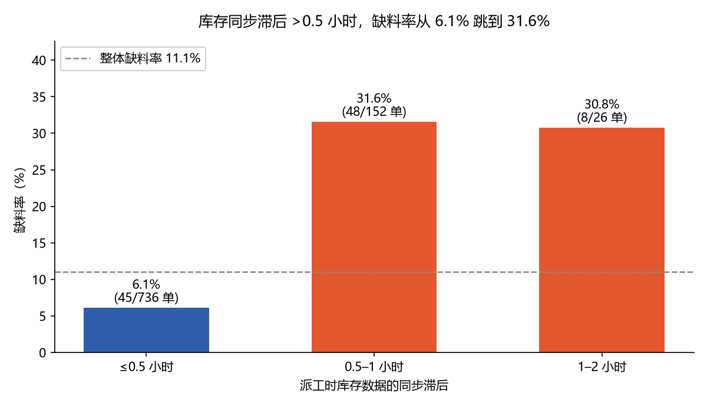
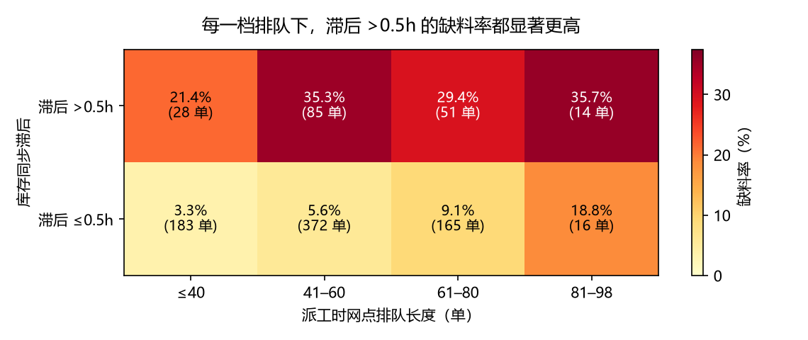

# 维保派工缺料分析 · dispatch_orders

> 业务目标：减少工程师因配件缺料导致的现场空跑，提升一次派工修复率。

## 0. 一句话结论

**缺料的根问题不是"库存不够"，而是"派工所依据的库存数据不新鲜"：库存同步滞后 > 0.5 小时的派工，缺料率 31.5%，是滞后 ≤0.5 小时（6.1%）的 5.1 倍；而账面库存高低与缺料率几乎无关。建议对「同步滞后 > 0.5h」的派工加一道风险标记，用 3,560 工时成本换回 6,720 工时，净省 3,160 工时/周。**

## 1. 我理解的业务问题

题目说的是"缺料导致空跑"，但**缺料至少有三种完全不同的成因**，对应的动作也完全不同：

1. **真的没料**（库存不足）→ 动作是补货 / 调拨
2. **账面有料、现场没料**（数据不准 / 同步滞后）→ 动作是派工前二次确认
3. **有料但调不过来**（网点忙、排队积压）→ 动作是调度优化

所以我把问题拆成三个可验证的子问题：
- Q1：缺料率是多少、代价多大？（先量化，避免拍脑袋）
- Q2：**账面库存、同步滞后、排队长度**三者中，谁是真正与缺料相关的？（找出可干预的杠杆）
- Q3：如果做风险标记，标记多少单、花多少工时、能换回多少？（用题目给的口径算 ROI，而不是只说"建议关注"）

主攻 **Q2 → 落在"库存同步滞后"**，因为它是唯一同时满足「强相关」+「可被系统改造」的变量；Q3 给出可执行的阈值和收益。

## 2. 数据长什么样（先看再算）

| 项 | 实际情况 |
|---|---|
| 规模 | 956 行 × 8 列（0.09 MB） |
| 时间跨度 | 2026-09-01 ~ 2026-09-07（按派工时区 +08:00 计） |
| 网点 | 5 个（内罗毕 / 蒙巴萨 / 基加利 / 达累斯萨拉姆 / 坎帕拉） |
| 配件大类 | 10 类 |
| 账面库存 | 0 ~ 30 件，均值 14.9 |
| 排队长度 | 5 ~ 98 单，均值 51.4 |

### 我发现的数据问题（以及我的处理）

1. **`job_completed` 有 42 行空值（4.4%）**——题目定义"空为未回传"。
   → 处理：**从分母剔除**，只对 914 张已回传工单计算缺料率；未回传的 42 张单独列示，不假设它们是成功或失败。
2. **两个时间字段时区不同**：`dispatch_time` 带 `+08:00`，`stock_synced_at` 是 UTC（`Z`）。
   → 处理：统一转 UTC 后再算差值，否则滞后会凭空多出 8 小时。
3. **`dispatch_id` 有 956 行但只有 910 个唯一值**（46 个重复）。
   → 处理：**按行分析，不按 dispatch_id 去重**——一行代表一次派工决策，这与题目"每次派工"的口径一致；重复 ID 本身作为数据质量问题写入「判断的边界」。
4. 未发现金额/数量字段为空、未发现时间倒挂（`stock_synced_at` 均早于 `dispatch_time`）。

## 3. 我是怎么分析的（决策路径）

1. **先立分母**：把"未回传"排除在缺料率之外，避免用 956 当分母把缺料率算低（11.05% vs 用 956 算的 10.56%）。
2. **先算代价**：101 × 120h = 12,120 工时 —— 这是后面所有方案的比较基准。
3. **逐个检验三个候选根因**，每个都做**分箱 + 缺料率**，看是否单调：
   - 账面库存 → **不单调**（0 件组 12.5%，21-30 件组 12.0%）
   - 排队长度 → **单调上升**（0% → 26.7%）
   - 同步滞后 → **断层式跳变**（≤0.5h 6.1% vs >0.5h 31.5%）
4. **交叉控制**：排队高和滞后大可能同时出现，所以做了「滞后 × 排队」二维交叉，确认滞后在每一档排队里都成立（见 §5）。
5. **最后才谈方案**：用题目给的 120h / 20h 口径，扫描阈值组合，算净节省，而不是只给"建议加强库存管理"这种无法验收的话。

## 4. 关键发现

### 发现 1：一周 101 次缺料，代价 12,120 工时

- 已回传 914 单：**813 单履约成功，101 单现场缺料**
- **一次派工修复率 88.95%，缺料率 11.05%**
- 按题目口径（每次缺料损失 120 小时）：**12,120 工时/周**

> 口径：分母只含 `job_completed` 已回传的工单；未回传 42 单（4.4%）不参与计算。

### 发现 2：账面库存与缺料率几乎无关（反直觉）

| 账面可用库存 | 工单数 | 缺料数 | 缺料率 |
|---|---|---|---|
| 0 件 | 24 | 3 | **12.5%** |
| 1-2 件 | 66 | 12 | 18.2% |
| 3-5 件 | 94 | 8 | 8.5% |
| 6-10 件 | 148 | 13 | 8.8% |
| 11-20 件 | 283 | 29 | 10.3% |
| 21-30 件 | 299 | 36 | **12.0%** |

库存最充足的组（21-30 件）缺料率 12.0%，与库存为 0 的组（12.5%）几乎一样。
**→ 说明"账面库存余量"这个信号本身没有区分力，不能拿它当派工闸门。**

### 发现 3：同步滞后是断层式信号（5.1 倍）

| 库存同步滞后 | 工单数 | 缺料数 | 缺料率 | 损失工时 |
|---|---|---|---|---|
| ≤0.5 小时 | 736 | 45 | **6.1%** | 5,400 |
| 0.5-1 小时 | 152 | 48 | **31.6%** | 5,760 |
| 1-2 小时 | 26 | 8 | **30.8%** | 960 |

滞后超过 0.5 小时的 178 单（19.5%），贡献了 **56 次缺料（占全部缺料的 55.4%）**。
滞后中位数只有 0.17 小时、P95 为 0.97 小时 —— **也就是说，同步只慢了一点点，缺料率就翻了 5 倍**。



### 发现 4：排队长度是次要信号（0% → 26.7%）

| 排队待派工单量 | 工单数 | 缺料数 | 缺料率 |
|---|---|---|---|
| 5-20 | 17 | 0 | 0.0% |
| 21-40 | 194 | 12 | 6.2% |
| 41-60 | 457 | 51 | 11.2% |
| 61-80 | 216 | 30 | 13.9% |
| 81-98 | 30 | 8 | **26.7%** |

单调上升，方向清楚，但**在控制排队后滞后依然成立**（见下节），说明排队是"加剧因素"，不是主因。

## 5. 根因交叉验证（这是"根问题"判断的依据）

把「滞后」和「排队」交叉，看缺料率（括号内为 缺料/单量）：

| 同步滞后 \ 排队 | ≤40 | 41-60 | 61-80 | 81-98 |
|---|---|---|---|---|
| **滞后 ≤0.5h** | 3.3% (6/183) | 5.6% (21/372) | 9.1% (15/165) | 18.8% (3/16) |
| **滞后 >0.5h** | **21.4% (6/28)** | **35.3% (30/85)** | **29.4% (15/51)** | **35.7% (5/14)** |

**在每一档排队长度里，滞后 >0.5h 的缺料率都高出 2-6 倍**，且低排队区间（≤40）差距最大（3.3% → 21.4%）。
→ **同步滞后是独立于"忙"的根因，不是排队长度的代理变量。**



同样的交叉对库存做了一次：库存 ≤2 件 / 3-10 件 / 11-30 件 在各排队档内的缺料率没有一致方向，进一步支持"账面库存不是有效信号"。

## 6. 建议（可执行 + 算得出收益）

### 建议 1（阶段一，本周可上）：对「同步滞后 > 0.5h」的派工加风险标记

- **触发条件**：`dispatch_time - stock_synced_at > 0.5 小时`
- **动作**：派工前要求现场/库管二次确认该配件实物，不确认不发车
- **收益测算**（用题目口径：标记 20h / 缺料 120h）：

| 项 | 数值 |
|---|---|
| 命中工单 | 178 单（19.5%） |
| 其中真缺料 | 56 单（精确率 31.5%） |
| 覆盖全部缺料 | 55.4% |
| 标记成本 | 3,560 工时 |
| 避免损失 | 6,720 工时 |
| **净节省** | **+3,160 工时/周** |

> 假设：标记后能拦住其中缺料的单（准确率 31.5% 意味着标记 3 单能挡 1 单，剩下的标记是"白花 20h"）。即便如此，净收益仍为正。

### 建议 2（阶段二，规则加严）：叠加高排队

- **触发条件**：滞后 > 0.25h **或** 排队 ≥ 90
- 命中 262 单（28.7%），精确率 32.1%，覆盖 **83.2%** 缺料，**净节省 4,840 工时/周**
- 适用场景：网点人手允许做二次确认时，用更宽的网换更高的覆盖

### 建议 3（治本，系统改造）：把「库存同步时效」变成派工系统的一等指标

- 现在系统只传"账面余量"，不约束"这个数字多久了"
- 建议在派工页面上直接显示：**「本数据同步于 X 分钟前」**，超过 30 分钟自动置灰并要求确认
- 理由：滞后中位仅 0.17h，说明系统**有能力**做到及时同步；缺料集中在 >0.5h 的少数单上，属于可修复的工程问题，不是业务无解

### 优先级（按损失工时排序的网点 / 配件）

**网点**（缺料损失）：基加利 3,000h（缺料率 13.0%）、内罗毕 2,880h（14.0%）、坎帕拉 2,520h（11.2%）、达累斯萨拉姆 2,160h（10.4%）、蒙巴萨 1,560h（7.1%）
**配件**：发动机组件 15.1%、电气控制器 14.9%、精密滤芯套包 13.3% 最高；动臂油缸密封件 3.6% 最低
**网点×配件最差组合**：基加利·电气控制器（27.3%）、内罗毕·发动机组件（29.4%）、蒙巴萨·发动机组件（23.8%）

## 7. 我的判断的边界（诚实）

1. **这是相关性，不是因果证明**：数据显示"滞后 >0.5h 与缺料强相关"，但没有随机实验。可能的替代解释：某些配件本身难以及时同步（同步慢和缺料同源于"该配件供应链混乱"）。若如此，标记规则仍有效（它筛出的就是高风险单），但"修复同步"未必能消灭缺料 —— **建议先做 2-4 周小范围试点验证**。
2. **样本只有一个星期（914 单）**，网点差异（基加利 13% vs 蒙巴萨 7%）可能是季节性/项目性波动，不宜据此立刻做资源调拨。
3. **`dispatch_id` 有 46 个重复值**，若这些是"同一张单多次派发"，则真实缺料成本可能被高估（同一单重复计缺料）；按现有字段无法判定，已在复现脚本中保留原始行，便于核对。
4. **未回传 42 单（4.4%）去向不明**，若它们系统性偏向缺料，缺料率会更高（上界：143/956 = 15.0%）。
5. ROI 里"标记即能拦住"是**乐观假设**：实际拦截率取决于执行；规则的价值在于"用 20h 的成本去筛 31.5% 命中率的高风险单"，这一点在悲观情形下仍成立（净收益 > 0 的临界精确率约 16.7%）。

## 8. 如果还有时间（48 小时内继续做）

- 用 `service_hub × part_category × 滞后` 做三因子分层，验证"网点×配件"高风险组合是否独立于滞后
- 对 `queue_length` 做时间序列，看排队是否领先于缺料（真正的时间因果）
- 把标记规则做成可回测脚本：滚动 7 天训练阈值、下 7 天验证，避免过拟合

## 9. 复现方式

```bash
# 环境：Python 3.12+ / pandas
python dispatch_analysis.py data/dispatch_orders.csv   # 总览 + 三个候选根因 + ROI 扫描
python sup.py                                          # 配件维度 + 交叉验证 + 规则对比
```

产物：
- `out/by_sync_lag.csv` — 滞后分箱的缺料率
- `out/by_stock.csv` — 库存分箱的缺料率
- `out/by_queue.csv` — 排队分箱的缺料率
- `out/by_hub_part.csv` — 网点×配件缺料排行
- `out/roi_scan.csv` — 阈值组合 ROI 扫描
- `out/cleaned_with_lag.csv` — 清洗后明细（含计算出的滞后小时数）

所有 README 中的数字均可由上述两个脚本在原始 CSV 上重算复现。
